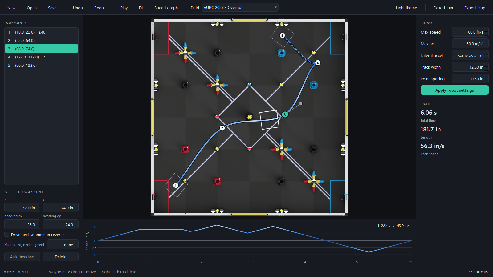

# PRISM Path Planner

An autonomous path planning tool for VEX robotics, built for the PRISM VURC team. Place waypoints on a 144×144 inch field, tune tangents, and export a time-stamped trajectory binary ready to load on a robot.



---

## How it works

### Path generation

Waypoints are connected using **cubic Hermite splines**. Each segment is defined by two endpoints and their tangent vectors, giving C1-continuous paths where heading is smooth across waypoints. Interior tangents are computed automatically using the Catmull-Rom convention, but can be overridden manually per waypoint.

### Sampling and curvature

The spline is resampled at **equal arc-length spacing** (0.5 in by default), so point density doesn't depend on tangent length or segment size. At each sample, heading comes from the spline's first derivative, and **signed curvature** is computed analytically:

```
κ = (x′y″ − y′x″) / (x′² + y′²)^(3/2)      (positive = turning left)
```

### Velocity profiling

Each point gets a speed ceiling, which is the smallest of:

- `v_max`
- the centripetal limit `sqrt(a_lat_max / |κ|)`
- the tank-drive outer-wheel limit `v_max / (1 + |κ|·W/2)` (when a track width `W` is set)

A **bidirectional pass** then enforces `a_max`. The forward pass accelerates up to the ceiling, and the backward pass guarantees the robot can slow or stop in time. Angular velocity is `ω = v·κ`. Robot constants live in `profiler/config.py::RobotConfig`.

### Export formats

Two export options are available. Each trajectory point is:

| field | unit |
|---|---|
| `x`, `y` | in |
| `theta` | rad, CCW from +x; the direction the robot faces (path direction + π when reversed) |
| `velocity` | in/s, negative when driving backwards |
| `omega` | rad/s |
| `curvature` | 1/in, signed, in the robot's frame, so `omega = velocity × curvature` always holds |
| `timestamp` | s |

**`.bin` — compact binary (SD card)**

```
char[4] "PRTJ" | uint32 version (2) | uint32 point count
[float32 x, y, theta, velocity, omega, curvature, timestamp] × N
```

The file is little-endian. `load_trajectory()` in the PRISM template reads it and rejects files with the wrong magic or version.

**`.hpp` — C++ header (embedded in firmware)**

Generates a `constexpr std::array<TrajectoryPoint, N>` that you include directly in your robot project. No SD card required as the path is baked into the binary. The header includes `PRISM/auton/traj_loader.h` for the `TrajectoryPoint` type. For use outside the PRISM template, `export_trajectory_header(..., standalone=True)` defines `Point`/`TrajectoryPoint` inline instead.

```cpp
#include "paths/my_path.hpp"

chassis.follow_trajectory(
    std::vector<TrajectoryPoint>(MY_PATH.begin(), MY_PATH.end())
);
```

The array name is derived from the filename (e.g. `red_auton.hpp` → `RED_AUTON`); invalid characters become `_`, and names starting with a digit get a `PATH_` prefix.

---

## Project structure

```
path-planner/
├── main.py                   # entry point: launches the Qt app maximized
├── fields/                   # built-in field images + fields.json (names, real sizes)
├── spline/
│   ├── hermite.py            # cubic Hermite interpolation and derivatives
│   ├── arclength.py          # equal arc-length sampling per segment, signed curvature
│   └── curvature.py          # Menger curvature (tests only)
├── profiler/
│   ├── config.py             # RobotConfig (limits, track width, spacing) + JSON load/save
│   ├── velocity_profiler.py  # speed ceilings and the forward/backward pass
│   └── trajectory.py         # TrajectoryPoint, generate_trajectory, state_at
├── exporter/
│   ├── binary_exporter.py    # versioned little-endian .bin
│   ├── header_exporter.py    # .hpp for firmware embed
│   └── path_file.py          # editable .path.json projects
├── planner/                  # editing model, no GUI code
│   ├── editor.py             # Editor (waypoints, undo/redo, files, stats) + Playback
│   ├── waypoint.py           # waypoint data (heading, reverse, speed cap)
│   └── fields.py             # field presets + FieldLibrary (custom images, remembered choice)
├── qt_ui/                    # PySide6 interface
│   ├── main_window.py        # toolbar, sidebars, status bar, dialogs, playback
│   ├── field_view.py         # the big interactive field
│   ├── speed_plot.py         # speed vs time strip
│   ├── panels.py             # waypoint list/editor, robot settings/stats
│   └── theme.py              # light/dark themes, stylesheet, speed colors
└── tests/                    # pytest; tests/qt runs the UI offscreen with pytest-qt
```

---

## Setup

Requires **Python 3.10 or newer** (tested on 3.14). NumPy 1.26+ and PySide6 have no builds for older versions, so on Python 3.8 or 3.9 `pip install` fails with "No matching distribution found".

```bash
git clone https://github.com/maxsr0/path-planner
cd path-planner
py -3.14 -m venv .venv          # Windows; elsewhere: python3 -m venv .venv
.venv\Scriptsctivate          # Windows; elsewhere: source .venv/bin/activate
pip install -r requirements.txt
python main.py
```

Dependencies: `numpy`, `PySide6` (Qt), `Pillow`; for tests, `pytest` and `pytest-qt` (run with `python -m pytest`).

---

## Usage

The app opens maximized with the field large in the middle. **F11** toggles full screen, and **F1** (or **? Shortcuts** in the status bar) lists every shortcut.

```
 toolbar:  New Open Save | Undo Redo | Play Fit Speed graph | Field ▾ ......... Light theme | Export .bin .hpp
┌──────────────┬──────────────────────────────────────┬──────────────┐
│ WAYPOINTS    │                                      │ ROBOT        │
│ list         │            the field                 │ settings     │
│ SELECTED     │                                      │ PATH         │
│ x y heading  ├──────────────────────────────────────┤ time, length │
│ reverse, cap │  speed vs time                       │ peak speed   │
└──────────────┴──────────────────────────────────────┴──────────────┘
 status bar:  cursor x/y  ·  hint for whatever is under the mouse  ·  ? Shortcuts
```

**On the field**
- **Click** to add a waypoint (it becomes selected). **Drag** a waypoint to move it; hold **Ctrl** to snap to whole inches.
- The selected waypoint shows a square **heading handle**. Drag it to bend the curve (grey = automatic, accent color = manual).
- **Shift+click** near the path to insert a waypoint into that segment. **Right-click** a waypoint (or press **Delete**) to remove it, and **Esc** deselects.
- **Mouse wheel** zooms, **middle-drag** pans, and **F** fits the field back to the view. Waypoints are numbered, and dashed squares show the robot's footprint at the start and end.

**Left sidebar:** the waypoint list (click to select). Below it is the selected waypoint's x, y and heading. Edits apply when you press Enter or leave the field, and each one is a single undo step. Changing the heading makes it manual; **Auto heading** returns it to automatic. The segment options apply to the segment *leaving* the selected waypoint:
- **Drive next segment in reverse.** It's drawn dashed and shows as negative speed. Where the direction changes, the path makes a cusp and the robot stops there.
- **Max speed, next segment** caps that segment (**none** = no cap).

**Right sidebar:** robot settings (max speed, max accel, lateral accel, track width, point spacing). **Apply robot settings** saves them to `robot_config.json`. Underneath are the path's total time, length and peak speed.

**Speed graph:** the path is colored by planned speed in one blue ramp, and the graph under the field uses the same colors, so its y axis is the color key. Hover over it to scrub the robot along the path, or press **Space** / **Play** for real-time playback. **Ctrl+G** hides it.

**Toolbar**
- **New / Open / Save** (Ctrl+N / Ctrl+O / Ctrl+S, Ctrl+Shift+S = Save As) work with editable `.path.json` files. Robot settings stay in `robot_config.json`, so one path can be exported for different robots. The title shows `*` for unsaved changes, and you're asked before anything is lost.
- **Field ▾** switches the background, like path.jerryio: VURC/V5RC 2027 Override (normal and Skills), a V5RC perimeter, **None (grid)**, or **+ Add image…** for your own top-down image cropped to the 144×144 in tiles.
- **Light theme / Dark theme** (Ctrl+T) switches the whole app, including the field chrome, path colors and graph.
- **Export .bin** (Ctrl+E) / **Export .hpp** (Ctrl+Shift+E) write the trajectory for the robot.

Your field and theme choices are remembered per user in `ui_prefs.json` (gitignored).

---

## Built for

[PRISM](https://prismrobotics.org) - VEX U Robotics Competition team.
