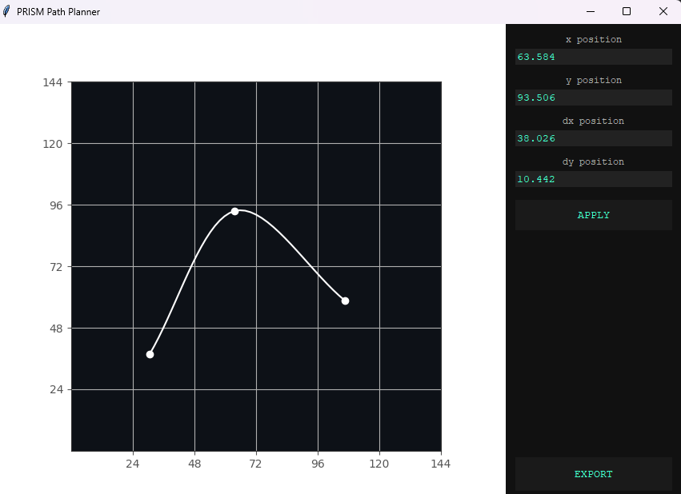

# PRISM Path Planner

An autonomous path planning tool for VEX robotics, built for the PRISM VURC team. Place waypoints on a 144×144 inch field, tune tangents, and export a time-stamped trajectory binary ready to load on a robot.



---

## How it works

### Path generation

Waypoints are connected using **cubic Hermite splines**. Each segment is defined by two endpoints and their tangent vectors, giving C1-continuous paths where heading is smooth across waypoints. Interior tangents are computed automatically using the Catmull-Rom convention, but can be overridden manually per waypoint.

### Velocity profiling

Once the path is sampled into discrete points, a curvature profile is computed using the **Menger curvature** formula:

```
κ = 2 |AB × AC| / (|AB| · |BC| · |AC|)
```

A maximum-velocity ceiling is derived from curvature and the robot's maximum lateral acceleration, then a **bidirectional pass** enforces the kinematic constraints:

- Forward pass: accelerate up to the curvature ceiling given `a_max`
- Backward pass: decelerate to guarantee the robot can stop or slow in time

This is the standard approach used in FRC and other mobile robotics competitions. Extremely simple and accurate.

### Export format

The trajectory is serialized to a compact binary file:

```
[int32: point count]
[float32 x, float32 y, float32 velocity, float32 timestamp] × N
```

A C++ loader on the robot side reads this directly into a `vector<TrajectoryPoint>` via `fread`, with no parsing overhead.

---

## Project structure

```
path-planner/
├── main.py                   # entry point, tkinter setup
├── spline/
│   ├── hermite.py            # cubic Hermite interpolation
│   └── curvature.py          # Menger curvature on discrete path
├── profiler/
│   ├── velocity_profiler.py  # bidirectional velocity pass
│   └── trajectory.py         # ties spline + profiler together
├── exporter/
│   └── binary_exporter.py    # packs trajectory to .bin
├── ui/
│   ├── app.py                # click/drag waypoint interaction
│   ├── field.py              # matplotlib field rendering
│   └── waypoint.py           # waypoint data + tangent logic
└── tests/
```

---

## Setup

Python 3.10+ recommended.

```bash
git clone https://github.com/maxsr0/path-planner
cd path-planner
pip install -r requirements.txt
python main.py
```

Dependencies: `numpy`, `matplotlib`

---

## Usage

- **Click** anywhere on the field to place a waypoint
- **Drag** a waypoint to move it and the spline updates live
- **Select** a waypoint to see and edit its position and tangent in the right panel
- **Apply** to commit manual tangent overrides
- **Export** to save a `.bin` trajectory file

The exported file is intended to be loaded on robot hardware during match. The binary format is documented above and straightforward to parse in any language.

---

## Built for

[PRISM](https://prismrobotics.org) - VEX U Robotics Competition team.
